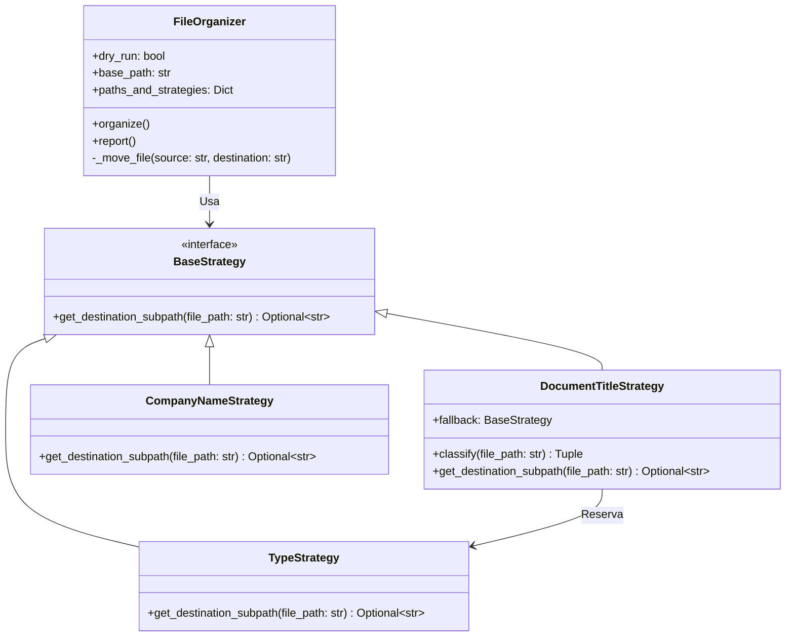

# Organizador Avançado de Arquivos

Uma solução em Python desenvolvida sob princípios SOLID para a organização inteligente de diretórios. O software analisa as extensões dos arquivos, lê o conteúdo de documentos PDF para classificar impostos e extrai metadados estruturados de Notas Fiscais eletrônicas para organizá-los em pastas hierárquicas.

## 🎯 Funcionalidades

*   **Organização por Tipo de Arquivo (`TypeStrategy`):** Agrupa arquivos comuns (como `.png`, `.jpg`, `.mp4`, `.txt`, `.xlsx`) em pastas correspondentes à sua extensão em letras maiúsculas.
*   **Classificação por Título do Documento (`DocumentTitleStrategy`):** Procura um termo conhecido na **região de título**, formada por três sinais complementares: o **nome do arquivo**, o metadado `/Title` e as primeiras linhas da página 1 (nunca o corpo inteiro). A pasta recebe o termo no plural — `DARF` → `DARFs`, `relatório` → `Relatórios`, `nota fiscal` → `Notas Fiscais`. O vocabulário vive em `src/document_terms.py`.

    As guias de arrecadação se separam por **jurisdição**, não pela frase genérica: municipal (`DAM` → `DAMs`), estadual (`DAE` → `DAEs`) e federal (`DARF` → `DARFs`). As três começam com "Documento de Arrecadação", então tratar essa frase como termo único mandava as três para `DARFs` — a frase federal precisa vir completa ("de Receitas Federais").

    O casamento é deliberadamente conservador: respeita limite de palavra, e acrônimos ambíguos exigem caixa alta e corroboração no título. Sem isso, `DAS` casaria dentro de "VENDAS" e a preposição "das" viraria guia do Simples Nacional. Os demais acrônimos casam em qualquer caixa, porque não são palavras do português — é o que permite reconhecer nomes de arquivo, sempre minúsculos (`andre darf irrf 052026.pdf`). PDF sem termo reconhecido cai na organização por extensão — melhor não classificar do que classificar errado.
*   **Extração de Metadados de Notas Fiscais (`CompanyNameStrategy`):** Extrai a data de emissão e a razão social do emitente no conteúdo do PDF e cria a estrutura `[Ano] / [MM - Mês] / [Nome da Empresa]` (ex.: `2026 / 08 - Agosto / EMPRESA LTDA`). Prefere a data rotulada como emissão; sem data válida usa `Sem Data`, nunca o mês corrente. Sem rótulo de razão social (com ou sem acento), `Desconhecido` — nunca a primeira linha do documento.
*   **Resolução de Conflitos e Duplicados:**
    *   Evita sobrescrever arquivos usando sufixo de timestamp baseado na data de modificação (`mtime`), com contador incremental caso esse nome também já esteja ocupado. O destino é reconferido antes do move: se ainda estiver em uso, a movimentação é abortada em vez de sobrescrever.
    *   Caso haja um arquivo com o mesmo nome de uma pasta de destino a ser criada, o arquivo conflitante é automaticamente renomeado com a tag `_CONFLITO_F_P` (mais um contador, se necessário) para permitir a criação do diretório.
*   **Interface Gráfica:** Janela única para informar a pasta, analisar sem mover nada, revisar a tabela e confirmar a movimentação. A linha de comando continua disponível pelo interpretador, com `--report`, `--real` e seletor de pasta.
*   **Pasta guarda-chuva (`ORGANIZED_ROOT_NAME`):** todo arquivo reconhecido vai para dentro de `Arquivos Organizados`, criada na raiz da pasta escolhida — as categorias (`DARFs`, `JPG`...) nascem dentro dela, e não soltas na raiz junto com o que já estava lá antes.
*   **OCR de PDF escaneado (`ocr.py`):** PDF sem camada de texto, cujo nome não basta, tem a página 1 lida pelo OCR nativo do Windows (pt-BR) — nada a instalar. Sem OCR disponível, nada muda. Para conferir no `.exe`: `OrganizadorArquivosGUI.exe --diagnostico-ocr saida.txt --pdf escaneado.pdf`.
*   **Migração de pastas antigas:** categorias criadas soltas na raiz por versões anteriores à 1.6.0 (`DARFs`, `PDF`, `JPG`...) são levadas para dentro de `Arquivos Organizados` e a pasta vazia é removida. Detecção conservadora: sem subpastas e com nome de categoria, ou nome de extensão com todos os arquivos daquela extensão. Reclassificação só "para cima".
*   **Incluir subpastas (opcional):** checkbox na janela ou `--subpastas` na CLI. Lê em qualquer profundidade, mostra a origem na tabela e nunca apaga pasta do usuário.

---

## 🛠️ Stack Tecnológica

*   **Linguagem:** Python 3.13+
*   **Leitor de PDFs:** `pdfminer.six` (para extração precisa de textos dos arquivos PDF)
*   **Mecanismo de Resiliência:** `tenacity` (retries automáticos com recuo exponencial para operações de I/O de arquivos)
*   **OCR:** `pypdfium2` (rasteriza a página) e `winrt` (`Windows.Media.Ocr`, o OCR que já vem no Windows)
*   **Compilação:** `PyInstaller` (compila o script em um executável `.exe` único)
*   **Testes:** `pytest`

---

## 🏛️ Arquitetura do Sistema

O projeto segue o padrão **Strategy** (GoF) para desacoplar as regras de organização das rotinas de movimentação de arquivos.



---

## 🚀 Como Executar

Use a interface gráfica (recomendado) ou a linha de comando pelo interpretador do Python. O build empacota **apenas a interface gráfica** — é o único `.exe` em `dist/`.

### 1. Interface Gráfica
```bash
dist\OrganizadorArquivosGUI.exe
```
Janela única: informe a pasta, clique em **Analisar** (que nunca move nada),
revise a tabela `arquivo → título detectado → pasta` e só então use **Mover
arquivos**, que confirma a quantidade antes de agir. A leitura dos PDFs roda em
thread separada, com barra de progresso e botão **Cancelar** — a janela continua
respondendo mesmo com centenas de documentos.

### 2. Linha de Comando (CLI)
A CLI não é empacotada: ela roda pelo interpretador, a partir desta pasta.
```bash
# Simular organização no diretório Downloads
..\.venv\Scripts\python.exe src\organizer.py --path "%USERPROFILE%\Downloads"

# Ver titulo detectado e pasta de destino de cada arquivo, sem mover nada
..\.venv\Scripts\python.exe src\organizer.py --path "%USERPROFILE%\Downloads" --report

# O mesmo, incluindo as subpastas
..\.venv\Scripts\python.exe src\organizer.py --path "%USERPROFILE%\Downloads" --report --subpastas

# Executar movimentação real no Desktop
..\.venv\Scripts\python.exe src\organizer.py --path "%USERPROFILE%\Desktop" --real
```
O botão **Analisar** da interface mostra a mesma informação que `--report`, em tabela.

### 3. Estendendo o vocabulário
Cada entrada de `TERMS` em `src/document_terms.py` declara o termo no singular; o
nome da pasta é derivado pelas regras de plural do português (`certidão` →
`Certidões`, `edital` → `Editais`, `DARF` → `DARFs`). Use `--report` para
descobrir quais títulos dos seus documentos ainda não têm termo.

---

## 🧪 Como Executar os Testes Unitários

As dependências ficam declaradas na raiz do repositório. A partir de `moverarquivos/`:

```bash
python -m venv .venv
.venv\Scripts\python.exe -m pip install -r requirements-dev.txt
.venv\Scripts\python.exe -m pytest advanced-organizer/tests
```

São 122 testes. Os de `test_regressions.py` tocam o filesystem
real de propósito — cobrem dois bugs de perda de arquivos que mocks não reproduzem.
